# Лабораторна робота №4 — CRUD-система «Фотоцентр»

Дисципліна «Організація баз даних»  
НУ «Чернігівська політехніка»  
Група КІ-251

**Виконали:**
- Іванеко Т.О.
- Ованенко Н.Р.
- Семеняко О.Г.

## Мета роботи

Розробити вебзастосунок для роботи з раніше створеною базою
даних, реалізувати CRUD-операції, пошук, пагінацію, перевірку
введених даних та безпечну взаємодію з БД.

## Опис проєкту

«Фотоцентр» — система обліку клієнтів, працівників, послуг,
замовлень, оплат та бронювань фотостудій.

Реалізовано перегляд, додавання, редагування та видалення
записів для всіх 12 таблиць бази даних.

Для розробки використано PHP 8.3, PDO, MySQL 8.4, HTML та CSS.
Запуск застосунку здійснюється через Docker Compose.

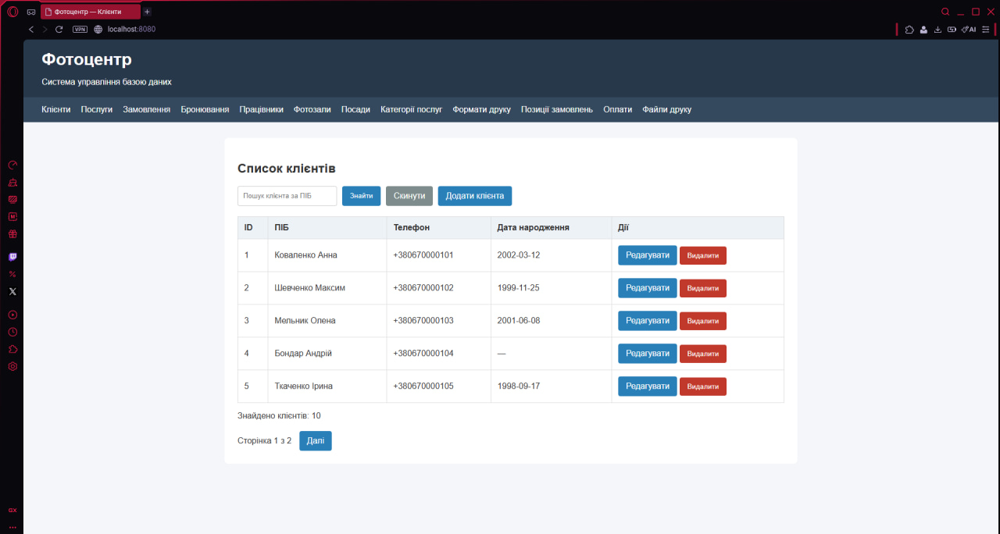

*Рисунок 1 — Головна сторінка вебзастосунку «Фотоцентр».*

## Запуск

Для запуску проєкту необхідно встановити Git та Docker Desktop.

Клонування репозиторію:

```bash
git clone https://github.com/hdqms/photocenter.git
cd photocenter
```

Створення файлу `.env` на основі `.env.example` (PowerShell):

```powershell
Copy-Item .env.example .env
```

Запуск контейнерів:

```bash
docker compose up -d --build
```

Перевірка стану контейнерів:

```bash
docker compose ps
```

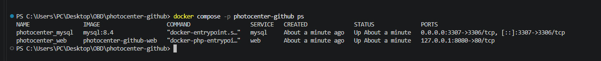

*Рисунок 2 — Запущені контейнери MySQL та PHP.*

При першому запуску база даних створюється та заповнюється
автоматично за допомогою SQL-файлів із папки `mysql/init/`.

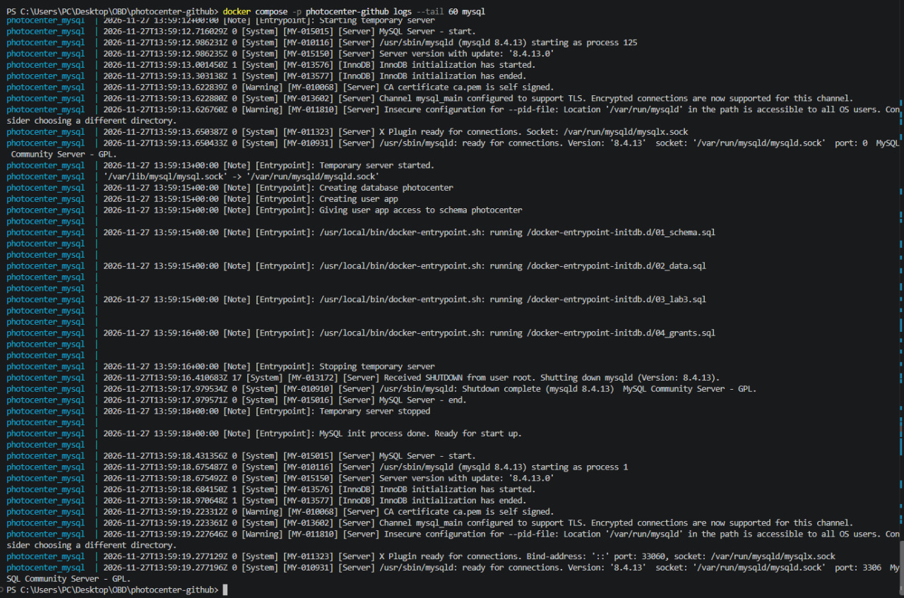

*Рисунок 3 — Автоматична ініціалізація бази даних.*

Після завершення ініціалізації сайт доступний за адресою:
[http://localhost:8080/](http://localhost:8080/).

Для зупинки контейнерів зі збереженням даних:

```bash
docker compose down
```

Для повного скидання бази даних:

```bash
docker compose down -v
```

Остання команда видаляє том із даними MySQL.
При повторному запуску база створюється заново.

## Структура проєкту

```text
photocenter/
├── frontend-prototype/   # Початкові HTML-макети
├── docs/screenshots/     # Результати тестування
├── mysql/
│   └── init/            # SQL-файли ініціалізації БД
├── public/
│   ├── css/             # Стилі сторінок
│   ├── index.php        # Список клієнтів
│   ├── client_form.php
│   ├── client_edit.php
│   ├── client_delete.php
│   ├── roles.php
│   ├── role_form.php
│   ├── role_delete.php
│   ├── list.php
│   ├── form.php
│   ├── delete.php
│   └── order_transaction.php
├── src/
│   ├── db.php
│   ├── functions.php
│   ├── crud.php
│   ├── entities.php
│   └── nav.php
├── Dockerfile
├── docker-compose.yml
├── .env.example
├── .gitignore
├── .mailmap
└── README.md
```

У папці `public/` знаходяться сторінки вебзастосунку,
а в `src/` — підключення до БД та спільні функції.

Для роботи з більшістю таблиць використовуються універсальні
сторінки `list.php`, `form.php` та `delete.php`.

## База даних

Використано базу даних `photocenter_lab3`, створену
на основі попередніх лабораторних робіт.

| Таблиця | Призначення |
|---|---|
| Client | Клієнти |
| Employee | Працівники |
| Role | Посади |
| Service | Послуги |
| ServiceCategory | Категорії послуг |
| Order | Замовлення |
| OrderItem | Позиції замовлень |
| Booking | Бронювання |
| StudioHall | Зали фотостудії |
| Payment | Оплати |
| PrintFile | Файли для друку |
| PrintFormat | Формати друку |

Таблиці пов'язані між собою за допомогою зовнішніх ключів.

Для роботи з базою `photocenter_lab3` користувачу `app`
надано права SELECT, INSERT, UPDATE та DELETE.

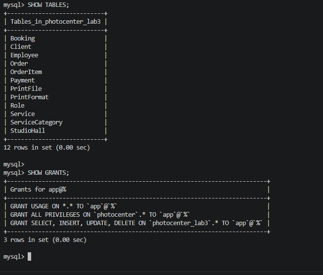

*Рисунок 4 — Перелік таблиць БД та права користувача app.*

## Реалізований функціонал

### CRUD-операції

Для всіх 12 таблиць бази даних реалізовано перегляд,
додавання, редагування та видалення записів.

Роботу CRUD перевірено на прикладі таблиці клієнтів.
Для цього створено новий запис із тестовими даними.

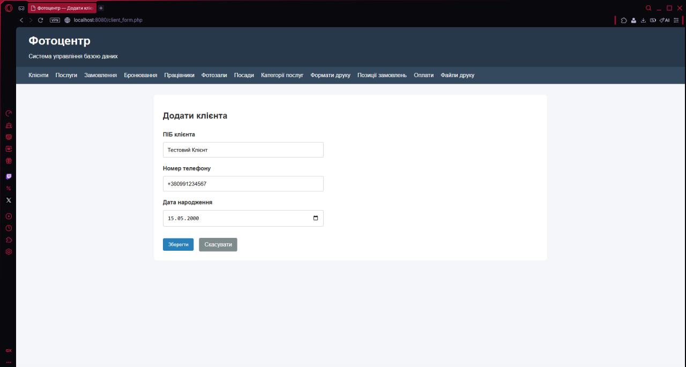

*Рисунок 5 — Заповнення форми додавання клієнта.*

Після збереження новий клієнт з'явився у списку,
а загальна кількість записів збільшилася до 11.

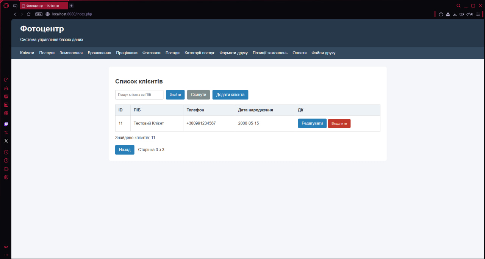

*Рисунок 6 — Результат додавання клієнта.*

Далі змінено номер телефону та дату народження
створеного клієнта.

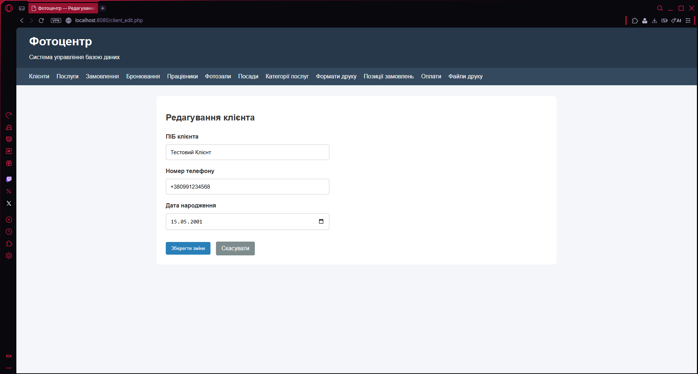

*Рисунок 7 — Редагування даних клієнта.*

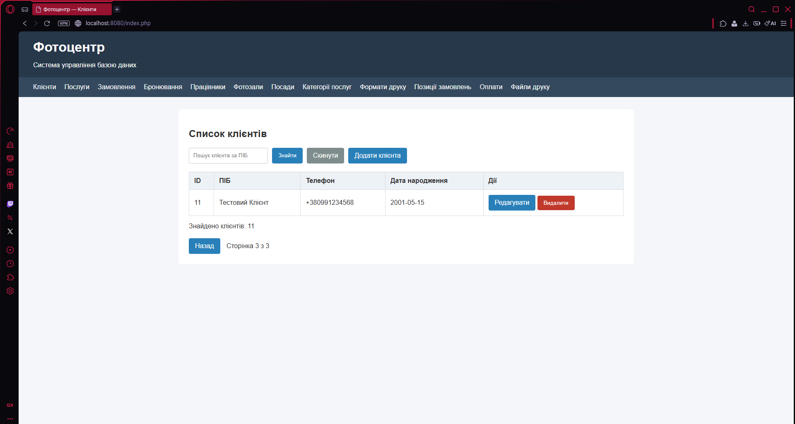

*Рисунок 8 — Оновлені дані клієнта.*

Перед видаленням запису застосунок запитує
підтвердження дії.

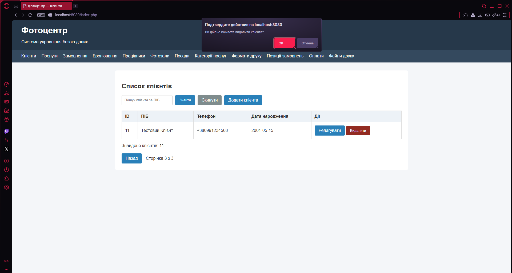

*Рисунок 9 — Підтвердження видалення клієнта.*

Після видалення тестового запису кількість клієнтів
знову становить 10.

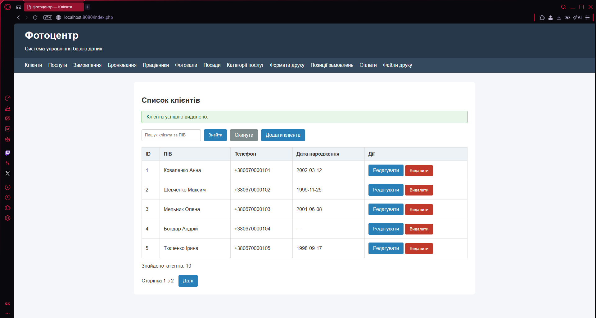

*Рисунок 10 — Результат видалення клієнта.*

### Пошук та пагінація

На сторінці клієнтів реалізовано пошук за ПІБ.
Для перевірки виконано пошук за частиною імені
створеного раніше тестового клієнта.

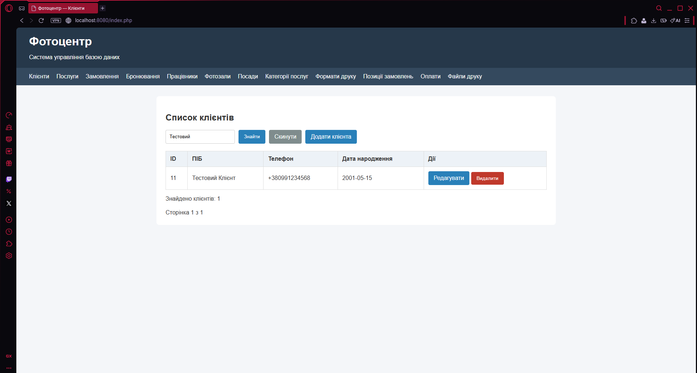

*Рисунок 11 — Результат пошуку клієнта.*

Для зручності перегляду список розділено на сторінки.
На одній сторінці відображається до п'яти записів.

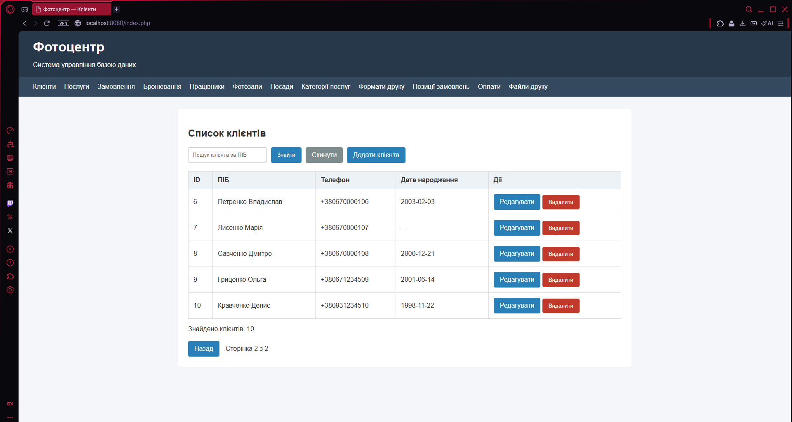

*Рисунок 12 — Друга сторінка списку клієнтів.*

### Робота із зовнішніми ключами

Для отримання даних із пов'язаних таблиць
використовуються SQL-запити з JOIN.

Наприклад, у списку замовлень замість ідентифікаторів
клієнтів та працівників відображаються їхні ПІБ.

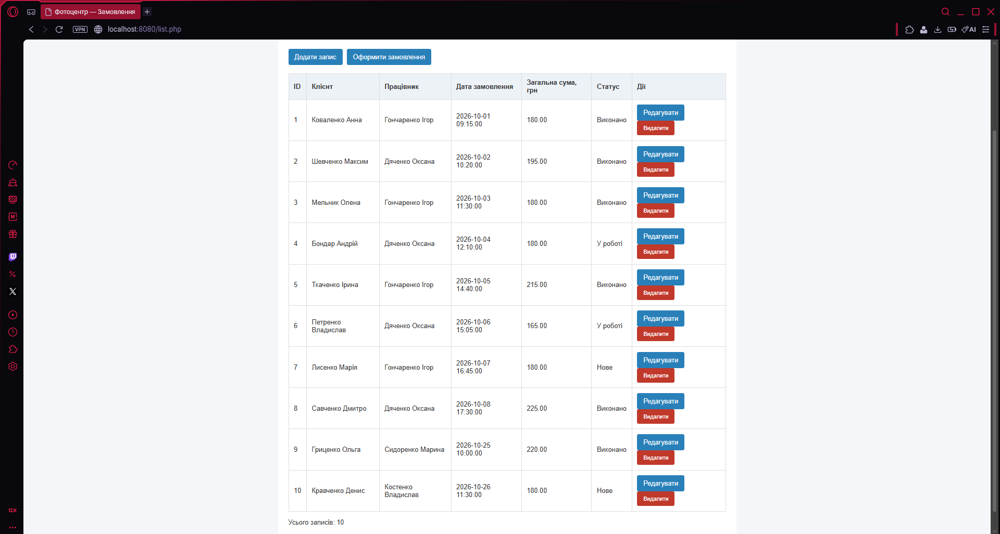

*Рисунок 13 — Відображення пов'язаних даних у таблиці замовлень.*

У формах додавання та редагування записів
для зовнішніх ключів використовуються випадаючі списки.
Їхні значення завантажуються з відповідних таблиць БД.

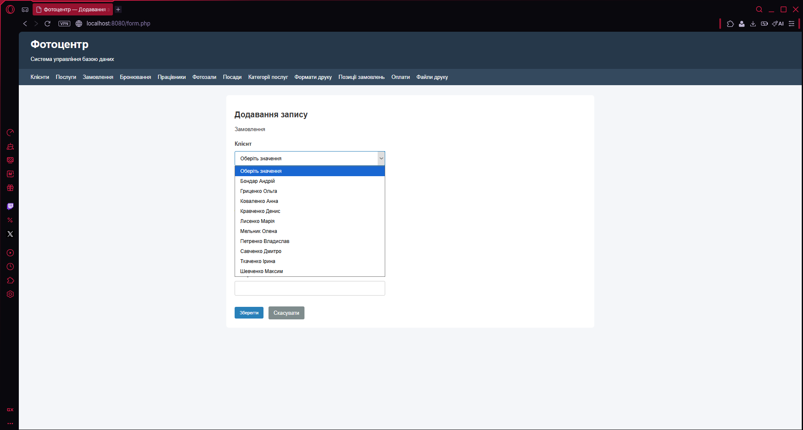

*Рисунок 14 — Вибір клієнта при додаванні замовлення.*

## Валідація та безпека

### Серверна валідація

Перед збереженням записів перевіряються обов'язкові поля,
довжина рядків, числові значення та формат дат.

Для перевірки валідації створено бронювання, у якому
час завершення вказано раніше за час початку.

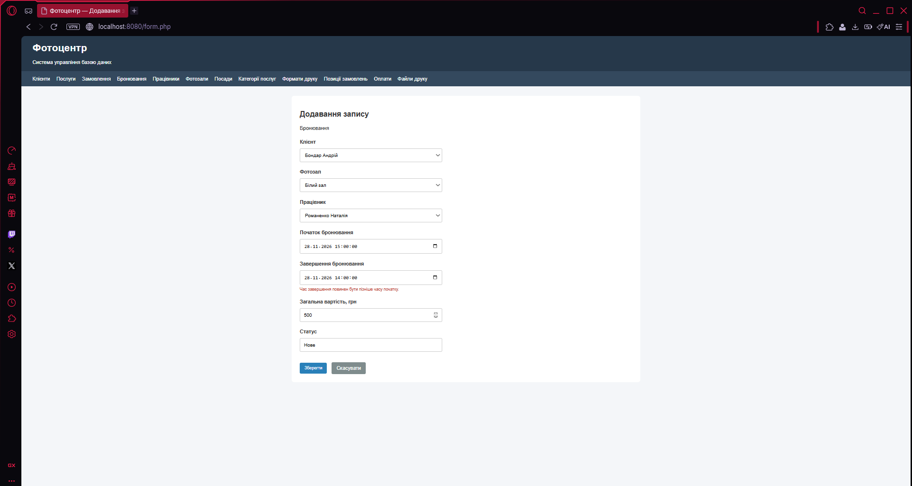

*Рисунок 15 — Результат перевірки часу бронювання.*

Застосунок вивів повідомлення про помилку біля відповідного
поля. Запис до бази даних не додано.

### Захист від SQL-ін'єкцій

Для роботи з базою даних використовується PDO.
Значення передаються в SQL-запити за допомогою
підготовлених виразів `prepare()` та `execute()`.

Для перевірки захисту в поле пошуку клієнтів введено
рядок `' OR 1=1 --`.


*Рисунок 16 — Результат перевірки SQL-ін'єкції.*

Введений рядок оброблено як звичайний текст.
Збігів не знайдено, помилок SQL не виникло.

### Захист від XSS

Для екранування даних при виведенні на вебсторінку
використовується функція `htmlspecialchars()`,
виклик якої винесено до функції `e()`.

Для перевірки в поле пошуку введено JavaScript-код.

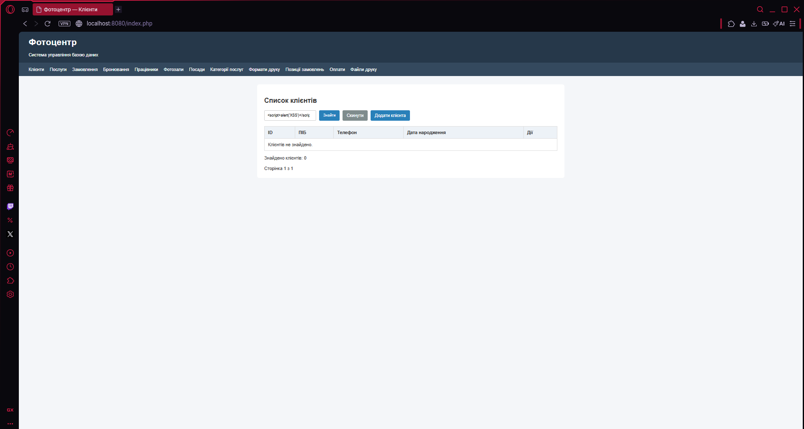

*Рисунок 17 — Результат перевірки XSS.*

Введений код відобразився як текст та не виконався.

### Обробка помилок MySQL

Передбачено обробку помилки дублювання запису (1062)
та порушення обмеження зовнішнього ключа (1451).

Для перевірки цілісності даних виконано спробу
видалення категорії «Фотодрук», з якою пов'язані послуги.

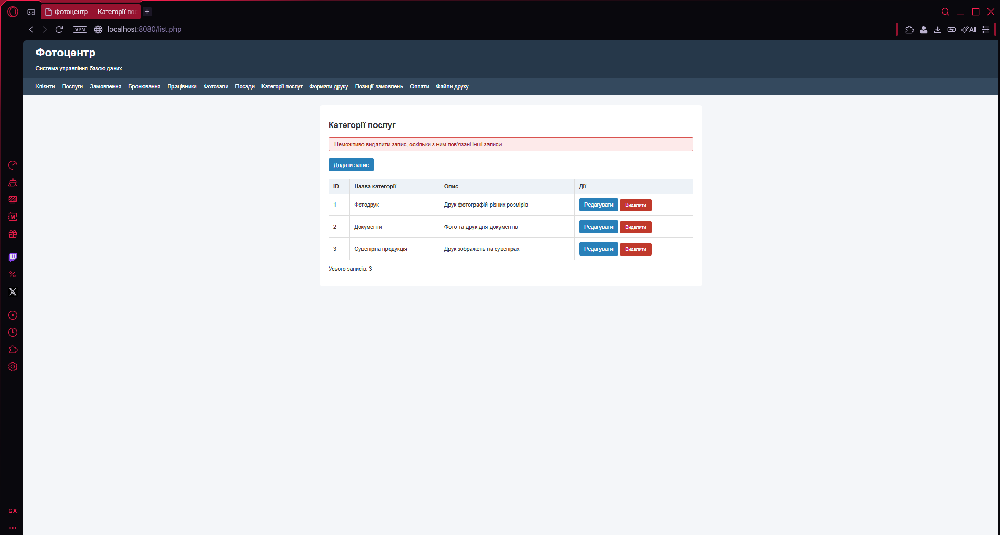

*Рисунок 18 — Спроба видалення пов'язаного запису.*

Видалення заборонено, усі записи залишилися в базі даних.

### CSRF-захист та обробка HTTP-запитів

Для захисту форм використовується CSRF-токен,
який зберігається в сесії та перевіряється
при обробці POST-запиту.

За допомогою curl виконано перевірки:

| Запит | Результат |
|---|---|
| Видалення через GET | 405 Method Not Allowed |
| POST без CSRF-токена | 419 Page Expired |
| Запит до неіснуючого розділу | 404 Not Found |

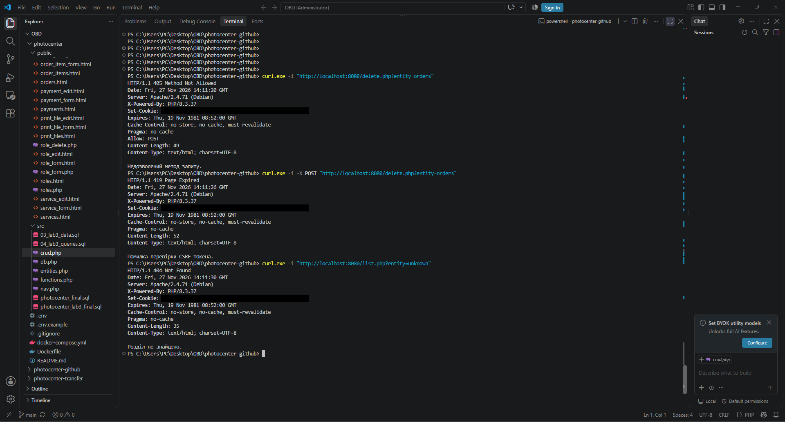

*Рисунок 19 — Результати перевірки HTTP-запитів.*

Після успішного збереження запису використовується
перенаправлення на сторінку списку (Post/Redirect/Get).
Це запобігає повторному надсиланню форми
при оновленні сторінки.

## Транзакції

Для оформлення замовлення створено окрему сторінку
`order_transaction.php`.

Замовлення та його позиція створюються в межах однієї
транзакції. Загальна сума розраховується автоматично
на основі ціни послуги та кількості.


*Рисунок 20 — Форма оформлення замовлення.*

### COMMIT

Для перевірки створено замовлення на друк п'яти фотографій
формату 10x15 вартістю 12 грн за одиницю.

Після успішного виконання транзакції замовлення №11
із загальною сумою 60 грн збережено в базі даних.

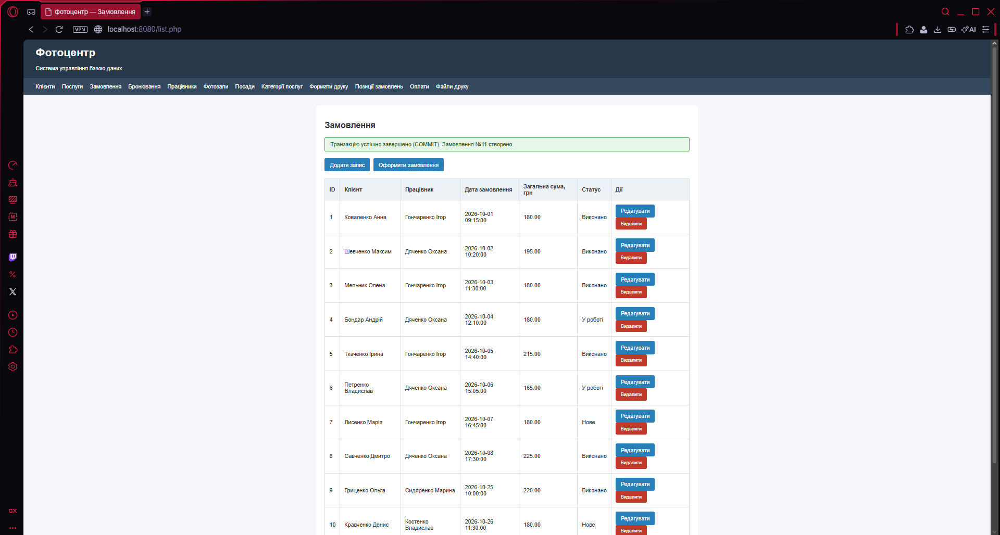

*Рисунок 21 — Успішне виконання транзакції.*

### ROLLBACK

Для перевірки відкату транзакції у формі передбачено
прапорець імітації помилки.

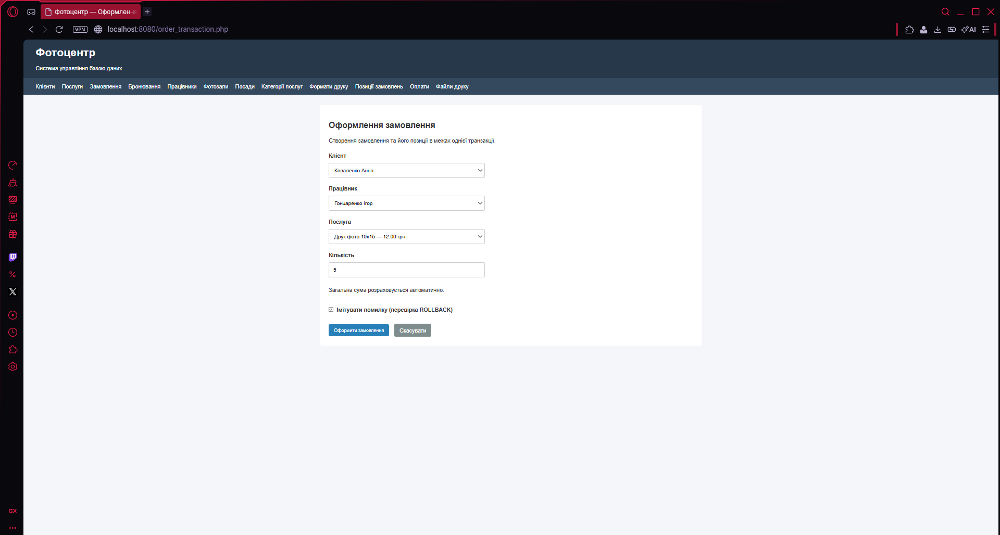

*Рисунок 22 — Оформлення замовлення з імітацією помилки.*

Після виникнення помилки виконано ROLLBACK.
Замовлення №12 та його позицію не збережено.

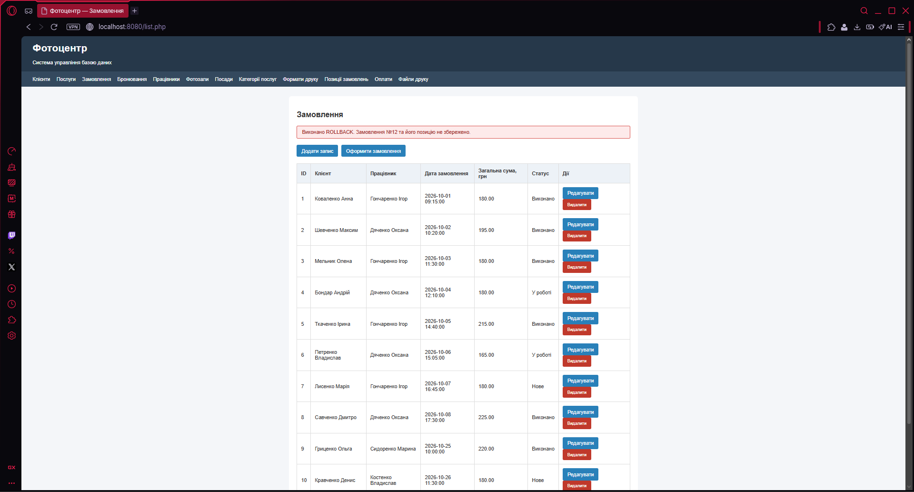

*Рисунок 23 — Результат відкату транзакції.*

Результати додатково перевірено за допомогою SQL-запитів.

| Таблиця | До перевірки | Після COMMIT | Після ROLLBACK |
|---|---:|---:|---:|
| Order | 10 | 11 | 11 |
| OrderItem | 21 | 22 | 22 |

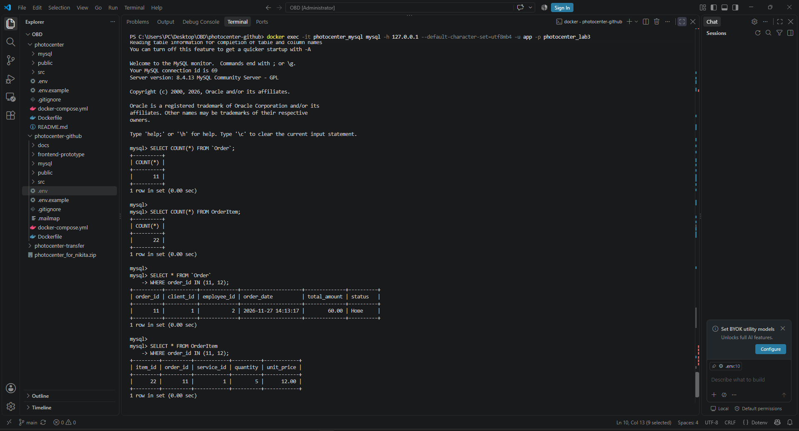

*Рисунок 24 — Перевірка результатів транзакцій у MySQL.*

## Командна робота

Для контролю версій та спільної роботи над проєктом
використано Git та GitHub.

Зміни завантажувалися окремими комітами відповідно
до виконаних завдань.

Історія комітів:
https://github.com/hdqms/photocenter/commits/main/

## Висновок

Розроблено вебзастосунок для роботи з базою даних
«Фотоцентр». Реалізовано CRUD-операції для 12 таблиць,
пошук, пагінацію та перевірку введених даних.
Перевірено роботу механізмів захисту та транзакцій.
Налаштовано автоматичне розгортання застосунку
і бази даних за допомогою Docker Compose.